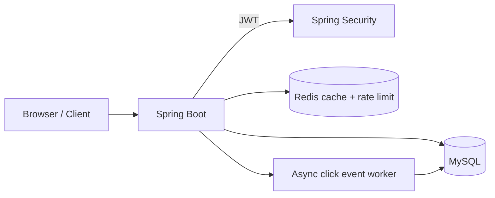

# URL Shortener & Analytics Service

A portfolio-grade backend starter built with Java 21, Spring Boot 3, MySQL 8, Redis, JWT, Docker Compose and OpenAPI. It includes account registration/login, user-owned short links, aliases, expiry/enable controls, redirects, click analytics, pagination, caching and distributed request limits.

## Implemented scope and important limits

- JWT bearer authentication; BCrypt password hashing; ownership checks for all management/analytics operations.
- Random 7-character Base62 codes from `SecureRandom`, protected by a MySQL unique constraint and retry handling. Custom aliases are validated and conflict-checked.
- Redirect checks enabled/expiry status and returns 302. Only `http` and `https` destinations are accepted; user-info URLs are rejected.
- Redis cache-aside mapping with TTL capped by link expiry. Management updates/deletes evict cache entries. Redirect resolution rechecks MySQL status even on cache hits to prevent stale disabled links.
- Redis Lua-based fixed-window limits: 20 creates/hour/client and 300 redirects/minute/client. Tune for your deployment. If Redis is unavailable the current policy fails open; add gateway limits and alerting.
- Click analytics are persisted asynchronously on a bounded in-process executor. This improves normal redirect latency but is not durable across process failure/queue saturation. Use a durable broker for production-grade event delivery.
- No geolocation is implemented. IP addresses are not stored. Browser/device values are heuristic User-Agent classifications.
- Dashboard click totals are aggregated across all of the account’s links by a database query.

## Architecture

See [docs/architecture.md](docs/architecture.md) and [docs/erd.md](docs/erd.md).



## Stack

Java 21, Spring Boot 3.5.6, Spring MVC, Spring Data JPA, Spring Security, Validation, JJWT, MySQL 8.4, Redis 7, Maven, JUnit 5, Mockito, Testcontainers, Docker Compose, Springdoc OpenAPI.

## Requirements

- Docker Desktop / Docker Engine with Compose plugin.
- For running without Docker: JDK 21, Maven 3.9+, MySQL 8, Redis 7.

## Run with Docker

1. Copy `.env.example` to `.env`.
2. Replace all passwords and set `JWT_SECRET` to a cryptographically random value of at least 32 bytes. Example generation: `openssl rand -base64 48`.
3. Run `docker compose up --build` from the project root.
4. Health check: `http://localhost:8080/actuator/health`.
5. Swagger UI: `http://localhost:8080/swagger-ui.html`.

MySQL schema is initialized from `database/schema.sql` on first volume creation. If you change the schema during local experimentation, reset volumes with `docker compose down -v` (this deletes local DB/Redis data).

## Run locally

Create the MySQL database and tables with `mysql -u root -p < database/schema.sql`. Start Redis. Export variables (or use your IDE run configuration):

```bash
export DB_URL='jdbc:mysql://localhost:3306/urlshortener?useSSL=false&serverTimezone=UTC'
export DB_USERNAME=urlapp
export DB_PASSWORD='your-db-password'
export REDIS_HOST=localhost REDIS_PORT=6379
export JWT_SECRET="$(openssl rand -base64 48)"
export APP_BASE_URL=http://localhost:8080
cd backend
mvn spring-boot:run
```

The application uses `ddl-auto: validate`; it will not create or mutate schema automatically.

## API quick guide

All management routes require `Authorization: Bearer <token>`.

| Method | Endpoint | Purpose |
|---|---|---|
| POST | `/api/auth/register` | Register |
| POST | `/api/auth/login` | Login |
| POST | `/api/urls` | Create short URL |
| GET | `/api/urls?page=0&size=20` | List owned links |
| GET | `/api/urls/{id}` | Retrieve one owned link |
| PATCH | `/api/urls/{id}` | Update destination, expiry, enabled state |
| DELETE | `/api/urls/{id}` | Delete owned link |
| GET | `/api/urls/{id}/analytics` | Link analytics |
| GET | `/api/dashboard` | Dashboard summary |
| GET | `/r/{code}` | Public redirect (302) |

### Example requests

Register:
```http
POST /api/auth/register
Content-Type: application/json
{"email":"demo@example.com","password":"ChangeMe123!"}
```
Create:
```http
POST /api/urls
Authorization: Bearer <token>
Content-Type: application/json
{"originalUrl":"https://example.com/articles/backend-design","customAlias":"backend-notes","expiresAt":null}
```
Example response (IDs and generated code vary):
```json
{"id":1,"shortCode":"backend-notes","shortUrl":"http://localhost:8080/r/backend-notes","originalUrl":"https://example.com/articles/backend-design","enabled":true,"expiresAt":null,"createdAt":"2026-11-11T06:00:00Z"}
```
Redirect:
```http
GET /r/backend-notes
```
Returns `302 Found` with a `Location` header. Expired/disabled links return 410; unknown codes return 404.

Import `postman/Url-Shortener.postman_collection.json` into Postman. After login, copy the returned token into the collection's `token` variable.

## Database design

Three normalized tables: `users` (account credentials), `shortened_urls` (one owner per link), and `click_events` (one event per click). See SQL and Mermaid ER diagram. Unique indexes enforce email and short-code uniqueness; foreign keys enforce ownership/event relationships. Indexes support owner-created listings, expiry inspection, and per-link time-series analytics.

Raw click events enable flexible analytics but grow rapidly. At scale, partition by event date, apply retention, and maintain daily aggregate tables for longer periods.

## Redis strategy

Cache-aside lookup: read `url:{code}`, fall back to MySQL, then cache valid destination with a TTL (up to one hour and never beyond link expiry). Mutations evict the key. The current implementation re-reads the DB row on a cache hit to verify disabled/expired state; this prioritizes revocation correctness but limits the DB savings. For a truly DB-light redirect path, use short TTL plus a versioned status cache and accept/document bounded revocation delay.

Rate limit uses a single Lua script to atomically increment and set the first-hit expiry, shared by all application replicas. Current fail-open behavior preserves availability during Redis failure; production deployments should add upstream protection and operational alerts.

## Security notes

- Keep `.env` out of version control; use a secret manager in deployment.
- Enforce HTTPS at ingress; set secure proxy headers and only trust forwarded IP headers from known proxies.
- Configure CORS explicitly before exposing browser clients; no permissive CORS policy is enabled here.
- Add email verification, password reset, account lockout, audit logging, secret rotation, and dependency scanning before production use.
- Rate-limit registration/login at the gateway too. Do not log bearer tokens or passwords.
- Define retention and disclosure for referrer/User-Agent analytics.

## Tests

Run `cd backend && mvn test`. Unit tests are included for code generation, URL validation/creation behavior, and rate-limit logic. Testcontainers dependencies are included for expanding to MySQL/Redis integration coverage; this initial delivery does not claim full container-backed integration coverage. CI should run the full Maven test suite and Docker image build.

## Deployment checklist

- Set strong unique DB, Redis, and JWT secrets.
- Use managed MySQL/Redis with TLS, backups, private networking, and least-privilege accounts.
- Terminate TLS at a trusted ingress; configure trusted proxy handling.
- Add readiness/liveness probes, metrics, structured logs, tracing, alerting and dashboards.
- Move click events to durable messaging; partition/aggregate event storage.
- Load test realistic redirect, write, cache-hit and cache-miss workloads before setting capacity claims.
- Add migration tooling (Flyway/Liquibase) for schema evolution.

## Project layout

```text
url-shortener-analytics/
├── backend/                 # Docker build context
│   ├── Dockerfile
│   ├── pom.xml
│   └── src/main/java/com/portfolio/urlshortener/
├── database/schema.sql
├── docs/                    # architecture and ERD
├── postman/                 # API collection
├── docker-compose.yml
├── .env.example
└── README.md
```
