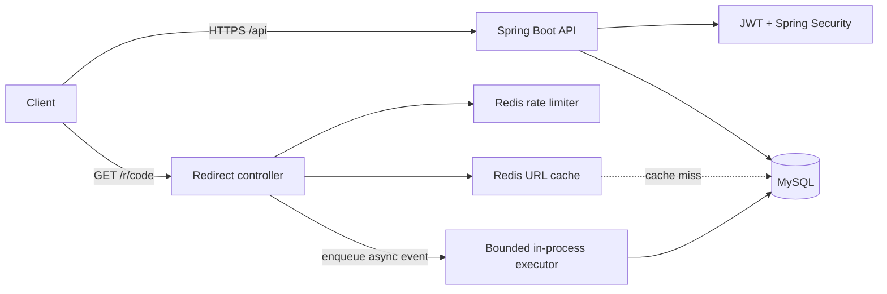

# Architecture and design notes

The redirect lookup uses cache-aside. A cache hit avoids fetching the destination value from MySQL; the database row is still read in this implementation to validate enabled/expiry state and obtain the row ID for analytics. This favors immediate disable/expiry correctness over the fastest possible cache hit. A later optimization can store a version/status marker and use short TTLs, while retaining invalidation and a consistency strategy.

Rate limits use a Redis Lua script (`INCR` + first-hit `EXPIRE`) so each increment/window initialization is atomic across application instances. The implementation fails open if Redis is unavailable: redirect availability is favored, but edge/API-gateway limits and alerts are recommended. Tune quotas to actual traffic and product policy.

Click events are submitted to a bounded local executor and persisted asynchronously. This keeps redirect latency independent of the insert in normal operation, but it is not durable: process crashes, queue saturation, or database outages can lose events. For stronger delivery guarantees, publish to Kafka/RabbitMQ/Redis Streams with retries and a dead-letter policy. Avoid treating user-agent device/browser parsing as authoritative.

## Scaling to millions of links

- Run stateless API replicas behind a trusted load balancer; share MySQL and Redis.
- Add MySQL read replicas for list/analytics workloads; keep redirect consistency requirements explicit.
- Partition or time-bucket click_events by date and retain only the necessary raw-event window; maintain daily aggregates for long-range analytics.
- Use a durable event broker for click ingestion and independently scale consumers.
- Monitor cache hit rate, Redis errors, redirect latency, DB pool saturation, queue depth, and rate-limit rejections.
- Consider a generated numeric ID encoded in Base62 if predictable allocation and sequence management are acceptable; random 7-character codes provide a large namespace but still require unique-index collision retries.
- Add CDN/edge redirect caching only with a revocation/expiry strategy. Do not cache disabled links beyond the invalidation bound.

## Privacy

No IP address or precise location is persisted. Referrer and user-agent-derived categories are retained for analytics; configure retention, disclose this to users, and consider hashing/truncating or disabling these fields based on applicable privacy requirements.
